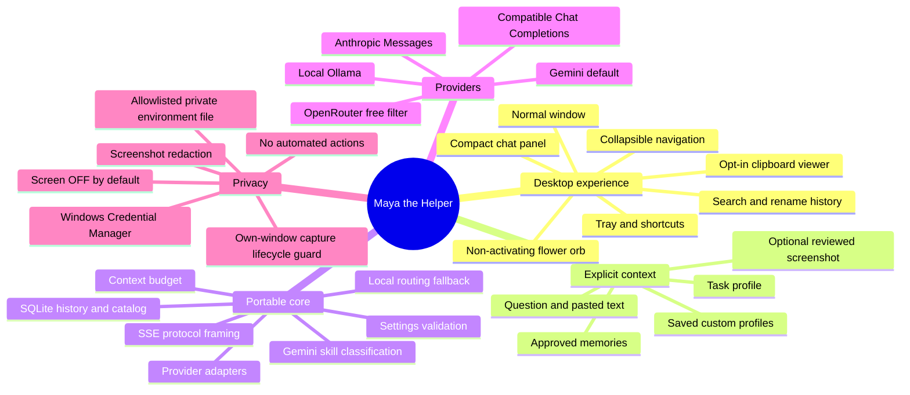

# Architecture

Maya has three boundaries: UI intent, portable request processing, and desktop capabilities.
The core never imports Qt, ctypes, screenshot libraries, or Windows key storage.



## Files worth understanding first

| File | Responsibility |
| --- | --- |
| `main.py` | DPI, data directory, logging, instance lock, local show channel, startup/shutdown |
| `ui/app.py` | Shared state, lifecycle and explicit user actions |
| `ui/windows.py` | Normal window, compact panel and animated orb |
| `ui/branding.py` | Sculpted ceramic petals, beveled jade base, bounded gold halo, hover tilt and visible-only glow/bloom |
| `ui/icons.py` | Cached vector navigation/settings/close symbols with matching strokes and native icon sizes |
| `ui/widgets.py` | Safe Markdown, message cards, focused composer, accessible elided status, follow-scroll and theme |
| `ui/settings.py` | Provider settings, editable memories, saved task profiles, About, model picker |
| `ui/history.py` | Debounced literal search of titles/message text, rename and confirmed deletion |
| `ui/clipboard.py` | Opt-in local live text preview, masking, debounce, reference scroll keys and explicit draft transfer |
| `ui/privacy.py` | Capture-exclusion lifecycle filter and verified/fallback/unavailable native status |
| `ui/capture_ui.py` | Region selection and irreversible pending-image black boxes |
| `ui/context_review.py` | Read-only local context, screenshot inspection and stage-specific approval |
| `ui/workers.py` | QThread jobs, incremental generation and pre-output retries |
| `core/types.py` | Model, message, image, request, event, public error, stop/deadline contracts |
| `core/providers.py` | HTTP transport and five explicit provider protocols |
| `core/streaming.py` | Incremental SSE parsing with bounded event sizes |
| `core/prompts.py` | 34 built-in skills, custom preferences, question-first local selection and pair trimming |
| `core/routing.py` | Allowlisted Gemini JSON classification, confidence validation and local fallback |
| `core/context.py` | Detached answer context, outgoing text sanitation and relevant-input fingerprint |
| `core/storage.py` | SQLite chats, turns, memories, feedback and fingerprint-scoped cache |
| `core/config.py` | Neutral defaults, validation, atomic non-secret settings |
| `core/safety.py` | Recognizable-secret redaction and narrow local abuse rejection |
| `platform/windows.py` | Foreground metadata, DPI, capture exclusion, global hotkeys |
| `platform/secrets.py` | Endpoint-scoped OS credentials and catalog identity hashing |
| `platform/environment.py` | One bounded allowlisted .env, no expansion, existing process values preserved |
| `capture.py` | MSS capture, monitor choice and bounded PNG/JPEG preparation |

## Request lifecycle

Optional review uses the same prepared Request passed to generation. It performs no credential,
catalog or provider access. Its relevant-input fingerprint is checked again before submission.
With Gemini routing enabled, the first review approves the separate routing call; the second review
approves the final answer context after skill/memory selection. A changed input invalidates consent.
Classifier preview and submission share `classification_payload()` so their excerpts cannot drift.

```mermaid
sequenceDiagram
  actor User
  participant UI as Normal / compact UI
  participant C as AppController
  participant D as Capture worker
  participant P as Prompt builder
  participant R as Optional Gemini classifier
  participant W as Generation QThread
  participant API as Selected provider
  participant DB as Local SQLite
  User->>UI: Type question; optionally Capture
  opt Explicit screen capture ON
    UI->>C: Capture action
    C->>C: Hide own windows; wait for compositor
    C->>D: Capture selected physical pixel bounds
    D-->>C: Image or typed error
    C->>UI: Region selection / preview / black boxes
    User->>UI: Attach reviewed screenshot
  end
  User->>UI: Send
  UI->>C: Submit shared draft
  C->>DB: Retrieve approved relevant memories
  C->>P: Rules + profile + preferences + trimmed history + image
  P-->>C: Validated Request
  opt Auto profile and Gemini routing explicitly enabled
    C->>R: Redacted excerpt/title and bounded profile descriptions
    R-->>C: Validated skill ID or local fallback
    C->>DB: Relevant approved memories for chosen skill
    C->>P: Rebuild answer with chosen instructions; validate again
    Note over C,R: Stop or draft/config/image change invalidates pending decision
  end
  C->>DB: Atomically save question and streaming marker; replace edited turn if requested
  C->>W: Start immutable request
  W->>API: Authenticated streaming POST
  loop Provider deltas
    API-->>W: SSE / NDJSON
    W-->>C: TextDelta via queued Qt signal
    C->>UI: Flush buffered text every 45 ms
  end
  opt Stop
    User->>C: Stop
    C->>W: Cancellation token; close HTTP stream
  end
  W-->>C: Finish / error / stopped + local latency
  C->>DB: Save final or partial assistant text
  C->>UI: Mark status and re-enable Send
```

## State and concurrency

The two composers/views subscribe to one controller. They share Message objects, one draft,
one selected model and one pending screenshot. Providers never access widgets. Background jobs
send queued signals to the UI; the controller retains QThreads until `finished` to avoid native
destruction crashes. A 45 ms timer coalesces display updates. Stop signals immediately and closes
the response off the UI thread. Quit cancels every job and waits asynchronously for cleanup.
Catalog requests carry a generation number. Starting another refresh or changing credentials
invalidates older success/error callbacks, including when the replacement request cannot start.

Retries happen only before visible output for network/5xx/429 failures, bounded by attempts and
a request deadline. `Retry-After` is honored. A partial stream is never automatically replayed:
the user chooses Regenerate or Continue. This avoids duplicate paid requests after partial output.
Cloud cancellation closes the client connection; it cannot guarantee cancellation of provider billing.

## Local schema and personalization

SQLite uses WAL, foreign keys, parameterized queries, and one connection per operation. `chats`
owns `messages`; deleted chats cascade to feedback. Memories contain explicit text and skill
scope. Retrieval ranks scope and term overlap, up to eight items. `catalog` stores public model
metadata, timestamp and endpoint/key hash, with a one-hour TTL. A key or endpoint change misses
the cache. No images, API keys or automatic screenshot-derived facts appear in the schema.
`begin_turn` commits new chats/questions/streaming markers and regeneration replacement in one
transaction. A failed insert rolls back the replacement. Draft clearing happens after this
commit; failed persistence preserves the old answer and draft. Disabling history also prevents
regeneration from deleting earlier saved text. Final-save errors keep the response visible.

Feedback is stored locally. It is not fine-tuning or a measured self-improvement benchmark.
Personalization improves when the user adds/corrects preferences. Approved memory is quoted as
untrusted contextual data; system safety and grounding rules retain priority.
Saved custom profiles and endpoint-scoped manual/verified-vision choices are bounded settings
data. A manual ID is not evidence of provider access. Unknown vision stays disabled until an
explicit user confirmation; declared text-only catalog metadata takes precedence.

## Capture and DPI

MSS and Win32 use physical pixels. Qt regions use logical coordinates on one chosen monitor;
RegionSelector maps its rectangle by that monitor image's width/height ratios. Monitor selection
handles negative coordinates. All-monitor capture uses the physical virtual-desktop rectangle.
Window capture uses the last external window's visible rectangle and rejects minimized/closed
windows. It does not recover occluded application contents. Native capture exclusion is requested,
and own visible windows are additionally hidden before capture. Cross-recorder exclusion is not
guaranteed. Images never upscale and are byte-bounded before transmission.
