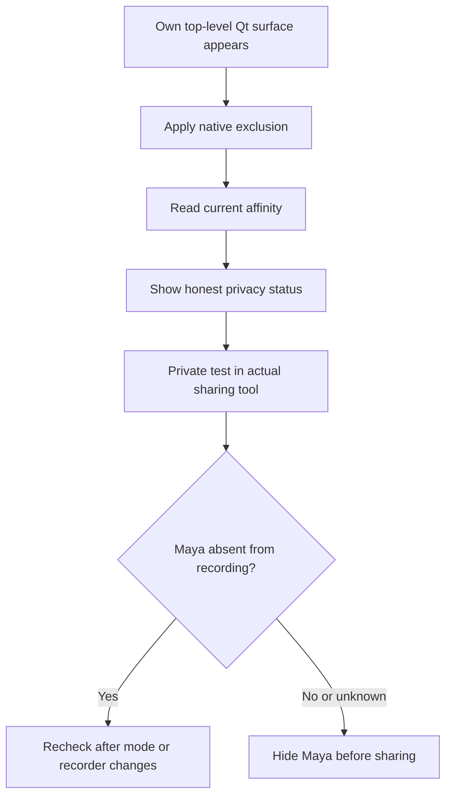

# Top-layer windows and screen sharing

Maya's main window starts pinned above ordinary desktop windows. The quick panel, flower orb
and clipboard viewer are topmost tool windows. Pin can be changed without losing the current
draft. The 480 × 560 main window and 360 × 440 reader keep the underlying application visible;
the reader supports a 320 × 360 minimum. Use Compact size after enlarging the main window.

The supplied Python reference requests Windows capture exclusion on a layered, non-activating
clipboard overlay. Maya preserves that intent while letting chat input deliberately acquire
focus. It uses the existing Qt event loop and pointer-safe Win32 bindings.

## What is implemented

`platform/windows.py` calls `SetWindowDisplayAffinity(handle, 0x11)` on Maya's own top-level
windows. `ui/privacy.py` installs an application event filter before the first window opens.
It protects normal/quick/orb windows, settings, preview dialogs, message boxes and menus when
they appear, and reapplies the request when Qt replaces a visible native handle. The filter
does not consume keyboard or mouse input and is detached at shutdown.

**More → Screen-share privacy** shows each visible Maya surface's current native status:

| Status | Meaning |
| --- | --- |
| Windows exclusion confirmed | The API accepted the request and read-back returned `0x11`. |
| Monitor-only fallback | Read-back returned `0x01`; this may blank recorded content rather than omit the window. |
| Request accepted; read-back unavailable | The setter succeeded, but the getter could not verify the affinity. |
| Capture exclusion not confirmed | A different affinity was returned. |
| Exclusion unavailable | Windows did not accept the request. |

These describe Windows state, not a test of the recorder you are using. Microsoft documents
`WDA_EXCLUDEFROMCAPTURE` for Windows 10 version 2004 and newer, subject to desktop composition,
and explicitly limits the protection. See the official
[SetWindowDisplayAffinity documentation](https://learn.microsoft.com/en-us/windows/win32/api/winuser/nf-winuser-setwindowdisplayaffinity)
and [read-back API](https://learn.microsoft.com/en-us/windows/win32/api/winuser/nf-winuser-getwindowdisplayaffinity).
Maya cannot guarantee invisibility to every screen-sharing method, camera or external device.

For Maya's own screenshot action, visible assistant windows are also temporarily hidden before
pixel acquisition and restored afterward. Every new capture still requires review. Screen OFF
blocks acquisition and clears pending/reusable screenshot context. Capture exclusion does not
prevent your explicitly submitted question or reviewed screenshot from reaching the selected model.

## Before presenting or recording

1. Use a private test recording with the exact screen-sharing tool and capture mode you plan to use.
2. Check the flower orb, quick panel, main window, settings, menus and notice dialogs in the recording.
3. Repeat after changing window mode, Pin or opacity. Confirm ordinary typing still works.
4. If any Maya surface appears, hide it with Alt+Shift+N or the tray before sharing that area.
   Share only the intended application window when your sharing tool supports it.
5. Keep Watch copied text OFF and Screen OFF unless you explicitly need them.

## Upgrade and compatibility plan

The lifecycle guard and read-back status are implemented and regression-tested. Further work
requires evidence from actual sharing software and hardware:

| Check | Current evidence | Next validation |
| --- | --- | --- |
| Topmost main/quick windows | Real Windows native flag and compact-layout test passes. | Mixed-DPI displays, elevated apps and fullscreen transitions. |
| Capture affinity | Native Windows reads `0x11` on main/quick/orb/clipboard, settings/history, a menu and a notice; both Pin transitions retain it. | Repeat on different supported Windows builds and hardware. |
| Dialog/menu lifecycle | Native surfaces plus synthetic Show/handle-change/failure/shutdown checks pass. | Test ordinary interaction during each recorder session. |
| Teams, Zoom, Meet/browser sharing and OBS | No recorder compatibility result recorded. | Test full screen and individual-window modes separately; record versions and results. |
| Older Windows / unavailable API | Unverified and monitor-only states are tested with fixtures. | Validate the hide workflow on physical unsupported systems. |

Any later fullscreen auto-hide option must remain explicit, preserve drafts and cancel clipboard
watching when hidden. Keep a visible status and manual hide path. Do not add recorder injection,
driver hooks or changes to another process to claim broader exclusion.

