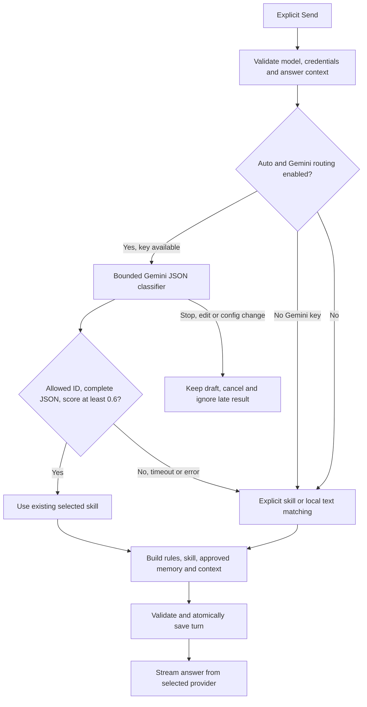

# Gemini smart routing and Maya skills

Maya's skills are reusable instruction profiles. They guide answers; they never execute commands,
edit workbooks, read hidden files or control other applications. Every installation starts with a neutral, empty profile.

## Turn on Gemini classification

1. In Settings → Providers, save a Gemini key, then Save & refresh models. Keys stay in Windows Credential Manager.
2. Open Settings → Smart routing. Enable **Use Gemini to choose a skill when task profile is Auto**.
3. Use Auto for a discovered Flash/Lite routing model, or choose an ID from the cached Gemini catalog.
4. Set the routing deadline (2–30 seconds; default 8) and save. Your answer provider may be different.
5. Leave the chat's task profile on Auto and Send. Stop during classification preserves the draft.

This is an additional Google request which may consume quota or incur cost. It is OFF by default,
including for local Ollama. With no fresh Gemini cache, the classification worker discovers accessible
models on Send. It uses only discovered generateContent Gemini IDs. Requested 3.5 Flash-Lite / 3.8 Flash
preferences apply when returned; IDs and generation access are never fabricated. For an absent explicit
routing ID, refresh Gemini or return to Auto. There is no automatic retry of classification.

## Data and trust boundaries

Classification receives a redacted question excerpt (maximum 2,000 characters), the last external window
title (200), and each built-in/custom profile's name and instruction excerpt (240). It does **not** receive
the screenshot, chat history, approved memories, language/name preferences or the answer provider key.
Descriptions are JSON-quoted untrusted data. Secret masking is limited to recognizable patterns;
review questions and custom profiles before enabling cloud routing.

The native Gemini SSE request uses `generationConfig.responseFormat.text` with JSON MIME type and an
enum of existing skill IDs. This follows Google's current
[structured output guide](https://ai.google.dev/gemini-api/docs/generate-content/structured-output?hl=en)
and [GenerateContent reference](https://ai.google.dev/api/generate-content#v1beta.GenerationConfig),
checked October 10, 2026. The result must contain only `skill_id` and a finite numeric `confidence`
between 0 and 1. Duplicate/extra fields, unknown IDs, boolean/string scores, oversized output, malformed
JSON, missing STOP markers, blocked/truncated output, network/auth/quota errors and timeouts all use
local fallback. Scores below 0.6 also fall back. This is an uncalibrated model estimate; no “best skill”
accuracy benchmark is claimed.

The classifier cannot create new system prompts or tools. It chooses exactly one existing skill.
The answer prompt is assembled in this order:

1. Fixed grounding, safety, uncertainty and capability rules.
2. Selected domain instruction; custom instructions are quoted user preferences within those rules.
3. Name/language/style and relevant approved memories, quoted as data.
4. Bounded complete conversation turns, current question and one optional reviewed screenshot.

The full answer is validated before classification and again with the chosen instruction afterward.
History is committed atomically only after the second validation. Editing the draft or changing profile,
settings/model, screen state or image invalidates a pending decision. Late worker replies are ignored.
Explicit profile selection bypasses the classifier. **More → Why this skill?** shows its provenance.

## Built-in instruction library

Preview the exact domain instruction in Settings → Smart routing. There are 34 built-in profiles.
More → Quick prompts offers starting questions. Shared rules favor concise answers in the small panel,
label screenshot gaps and uncertainty, and prohibit fabricated tests, quotations or current facts.
Auto local routing checks the question first, then the window title; explicit user selection always wins.

| Skill | What its guidance prioritizes |
| --- | --- |
| Everyday help | Immediate question, useful next steps, missing context |
| Commands & AI agents | Command components, scope, effects, dependencies and preview before destructive changes |
| Coding & debugging | Precise error, small fix, changed lines and verification |
| Python & notebooks | Interpreter/environment, traceback, state and data shapes |
| Web development | Semantics, accessibility, layout, browser/network errors and version assumptions |
| Excel & spreadsheets | Exact formulas, references, types, locale and visible-workbook limits |
| Documents & writing | Preserve meaning, improve supplied wording and separate factual corrections |
| PDFs & research | Definitions, examples, visible passages and no fabricated citations/results |
| Data science & SQL | Types, joins, leakage, units, nulls and read-only previews |
| Study & mathematics | Small teaching steps, equations, units and understanding |
| Slides & presentations | Message, structure, readable layout and grounded speaker notes |
| Application troubleshooting | Visible dialog, low-risk diagnostics and OS/context restrictions |
| Git & open source | Branch/remotes, conflicts, reviewable patches and preserving uncommitted work |
| Defensive security | Authorized analysis, evidence, credential protection and safe containment |
| English & communication | Clear faithful wording/translation and concise explanations of revisions |
| Career & interviews | Supplied experience, truthful achievements and realistic practice |
| Design & accessibility | Hierarchy, contrast, keyboard/error recovery and limits of screenshot-only audits |
| Systems & deployment | OS/service/environment, inspection, permissions, impact and rollback |
| Testing & quality | Observable behavior, boundary cases, meaningful checks and honest integration evidence |
| Projects & productivity | Small steps, constraints, dependencies, acceptance criteria and estimates |
| APIs & integrations | Method/URL/auth/payload, pagination, timeouts, rate limits and safe retry boundaries |
| Algorithms & problem solving | Examples, invariants, correctness, edge cases and time/space complexity |
| Statistics & experiments | Sampling, uncertainty, confounding, effect sizes and reproducible calculations |
| Engineering & hardware | Units, dimensional checks, explicit physical assumptions and safe diagnostics |
| Business & finance literacy | Supplied figures, actual versus forecast, units and limits of general guidance |
| Meetings & notes | Faithful summaries, supplied owners and agreements, open questions and useful structure |
| Health terminology | Plain-language terms, uncertainty and qualified care; no diagnosis or prescribing |
| Files & data formats | Encoding, delimiters, schemas, data types and validation before overwriting |
| Audio & video editing | Visible timeline, frame/sample rates, export settings and reversible changes |
| CAD & spatial design | Units, coordinates, sketch constraints, physical assumptions and visible geometry |
| Customer support & service | Supplied facts, clear empathetic replies, missing context and minimal personal data |
| Wi-Fi & networking | Read-only connectivity/DNS checks, OS context and impact before settings changes |
| Assistive tools & access | Keyboard navigation, screen readers, captions and alternatives matched to the user's tool |
| Forms & applications | Supplied fields and facts, missing information, sensitive identifiers and review before submission |

The instruction-library selector supports case-insensitive name search, including words within a
skill name. Selecting an entry previews its guidance locally; it does not change the chat profile,
enable classification or make a provider request.

Up to 20 custom profiles can be created in Task profiles. Gemini sees their bounded descriptions when
routing is enabled. Their full instruction is used only for the chosen answer. Deleting a profile leaves
its saved memories inspectable; reassign those scopes in Memory. Safety rules retain priority for all skills.

Tests cover native mocked Gemini payloads, streaming JSON, custom selection, fallback types, separate
answer providers, correct scoped memory, cancellation/edit races and quiet catalog socket deadlines.
Real-key classification, selection quality and latency remain unverified until live testing is requested.
